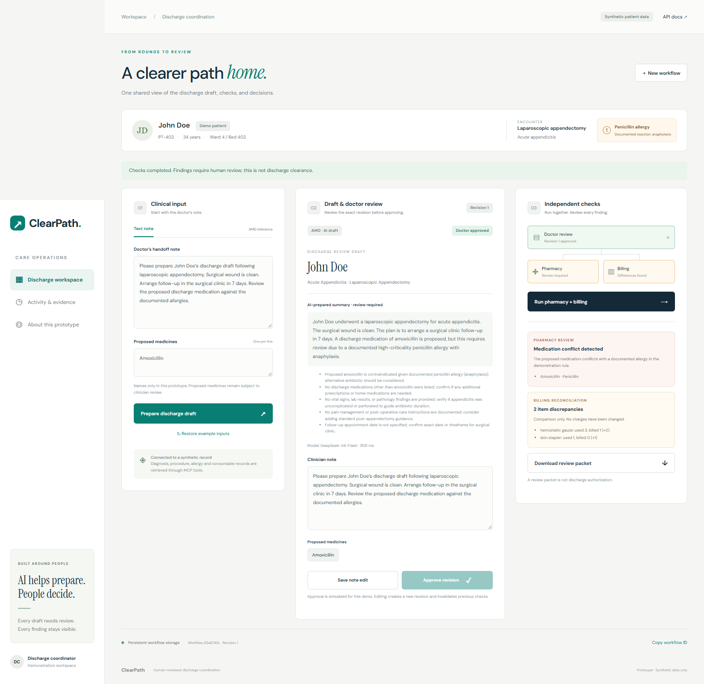
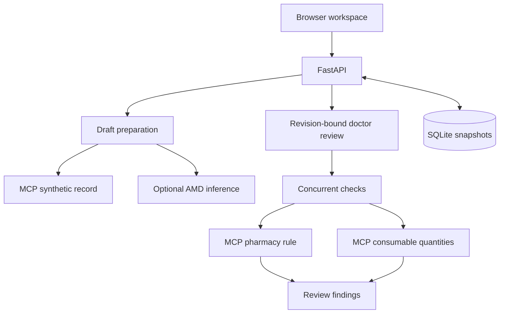

# ClearPath — Discharge Coordination

A shared discharge workspace for clinical drafts, human review, and concurrent
pharmacy and billing checks. Built for AMD Developer Hackathon: ACT III,
Track 2 — Health and Wellbeing.

**[Try the live app](https://clearpath-discharge.onrender.com)** ·
**[Watch/download the AMD demo](https://github.com/Promizir/clearpath-discharge/releases/download/v0.1.0/ClearPath-demo-AMD.mp4)** ·
**[Submission assets](https://github.com/Promizir/clearpath-discharge/releases/tag/v0.1.0)**

The public Render deployment passed the full AMD-backed browser workflow,
report download, reload restoration, edit invalidation, and mobile checks.



## Working prototype

1. Retrieve a synthetic patient record through an MCP tool.
2. Prepare a structured draft, optionally using an AMD-hosted model.
3. Review and explicitly approve the current revision.
4. Run pharmacy and billing checks concurrently through MCP.
5. Review the allergy-rule match and consumable quantity discrepancies.
6. Download a review packet or reopen the persisted workflow.

Editing the note creates a new revision and clears approval, findings, and any
AI summary based on the old note. Obsolete worker results are rejected.

**Synthetic demonstration only.** Approval is simulated and the pharmacy rule
checks one exact example. Completed checks do not grant clinical clearance.
Billing reports differences without changing charges.

## Run locally

Requires Python 3.12 or newer. From the repository root, in PowerShell:

```powershell
python -m venv .venv
.\.venv\Scripts\python.exe -m pip install -r requirements.txt
.\.venv\Scripts\python.exe -m uvicorn main:app --host 127.0.0.1 --port 8000 --workers 1
```

Open <http://127.0.0.1:8000>. API documentation is at `/docs`.
On macOS/Linux use `.venv/bin/python` instead of `.\.venv\Scripts\python.exe`.

Without model credentials, the app assembles a structured draft labeled
**Structured demo**. This mode does not establish AMD usage.

## AMD inference

Copy `.env.example` to `.env` only if a private `.env` does not already exist.
Configure the values supplied by your AMD account:

```dotenv
AI_PROVIDER=AMD
AMD_API_KEY=your_private_key
AMD_BASE_URL=https://developer.amd.com.cn/radeon/api/v1
AMD_MODEL=DeepSeek-V4-Flash
```

The URL/model match the supplied Radeon API example. Verify that your account
grants access; other AMD offerings may have different values. Restart the server
after changing configuration. Never commit `.env`.

The browser requests AI when all settings are present. Credentials remain on the
server. A successful response is schema-validated and displays the model name
and elapsed request time. Errors never silently become mock output. Direct API
requests opt in with `use_ai: true`. The single-process public demo limits AI
calls to 30 attempts per hour and two in flight, resetting on process restart.

**Live AMD API call verified:** DeepSeek-V4-Flash returned a valid synthetic draft
in 60,814 ms on 18 October 2026. See
[execution evidence](submission/amd-execution-evidence.json). This is a single
integration check, not a benchmark or independent hardware attestation. Unit
tests separately use a mock HTTP transport.

## Architecture



| File | Responsibility |
| --- | --- |
| `schemas.py`, `mock_ehr.json` | Typed contracts and synthetic source data |
| `mcp_server.py` | Read-only patient, pharmacy, and billing tools |
| `agents.py`, `providers.py`, `config.py` | Tool clients and optional inference |
| `workflow.py` | Approval, revisions, concurrency, stale-result rejection |
| `storage.py` | Durable latest snapshots |
| `main.py`, `static/` | HTTP API and responsive browser dashboard |
| `tests/` | Workflow, tools, persistence, API, inference boundary checks |
| `submission/` | Cover, pitch, demo script, and submission copy |

MCP clients use an in-process FastMCP transport. `python mcp_server.py` also
exposes these tools over stdio. SQLite stores latest state, not full history.

## Verify

```powershell
.\.venv\Scripts\python.exe -m unittest discover -s tests -v
```

Optional browser test (requires Playwright and Chrome) against a running app:

```powershell
.\.venv\Scripts\python.exe scripts/qa_dashboard.py --url http://127.0.0.1:8000
```

It exercises creation, approval gating, both checks, downloads, reload
restoration, revision invalidation, and mobile layout. If AMD is configured,
the browser test makes one real model call. Unit tests do not need credentials.

## Deploy and submit

The Dockerfile serves the full app on port 7860 (or `$PORT`) using one worker.
The README metadata supports Hugging Face Docker Spaces; `render.yaml` supports
Render. See [deployment steps](docs/DEPLOYMENT.md).

[Deploy this repository to Render](https://render.com/deploy?repo=https://github.com/Promizir/clearpath-discharge)
and enter your private `AMD_API_KEY` when prompted. The blueprint preconfigures
the verified endpoint/model and selects the free service plan. Review the
deployment settings in your own account before creating it.

SQLite survives process restarts while its filesystem remains intact. Cloud
container replacement needs attached durable storage; ephemeral hosting can
lose snapshots. Set `DATABASE_PATH` to a writable volume path when configured.
Use one worker and one replica.

[Submission copy and checklist](submission/SUBMISSION.md) accompany the PNG
cover and seven-slide PDF/PPTX deck.

## Scope

Implemented: text input, optional AMD summary, revision-aware simulated approval,
concurrent deterministic checks, stored snapshots, and review packet download.
Real EHR/FHIR integration, authenticated clinical roles, audio/vision, insurance
authorization, patient messaging, and discharge release are future work. The
fixture is a custom schema, not a conformant FHIR resource. Model prose is
untrusted draft text requiring human review.

The original mentoring lessons are preserved in
[docs/LEARNING_NOTES.md](docs/LEARNING_NOTES.md).
